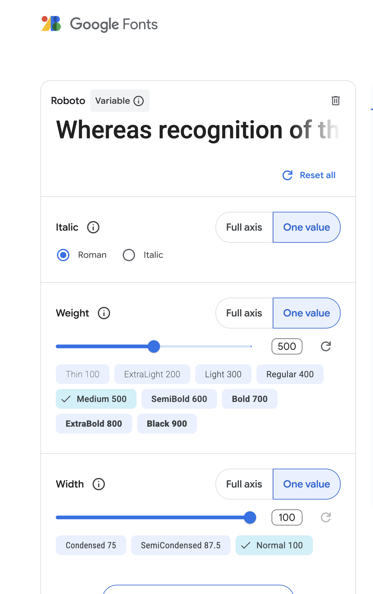

# Moyo header

Create an HTML page with the header using `flexbox` based on the
[Figma Mockup](https://www.figma.com/file/1sog2rmfyCjnVxkeZ3ptnc/MOYO-%2F-Header?node-id=0%3A1&mode=dev).

The page should match the design Pixel Perfect: all the sizes, colors
and distances MUST be the same as on the design.

> Here are the
[Layout Tasks Instructions](https://mate-academy.github.io/layout_task-guideline)

---

## Requirements

- reset browser default margins
- use [Roboto font](https://fonts.google.com/specimen/Roboto):
  select ONLY **roman** style, **medium (500)** weight and **normal** width
  for embedding.
  **THIS STEP IS IMPORTANT, OR YOUR AUTO TEST MAY FAIL.**
- use semantic tags: `<header>`, ``, `<nav>`, `<ul>`, `<li>` and `<a>`
- the header should stretch the full page width (don't use a horizontal margin)
- the height should be set for nav links (not the header), take it from the design
- header content should be vertically centered
- the logo should also be a link with an image inside
  (from [src/images](src/images))
- the logo should not be a part of the `<nav>`
- ❗️ the blue link with a line below should have a class `is-active`
  in addition to any other classes you add
- ❗️ add `data-qa="hover"` attribute to the 4th link for testing
- link color should be changed on `:hover`
- use the `::after` pseudo-element and position it relative to a link
  with `is-active` class
- ❗️ don't use the flex `gap` property for indents.
  Use margins instead (it's not supported in tests)
- there should not be margins before the first and after the last list items
- don't just copy all styles from Figma
- nav links should not have any padding but have the text centered

---

## Checklist

❗️ Replace `<your_account>` with your GitHub username
and copy the links to the Pull Request description.

- [DEMO LINK](https://eg3844540-svg.github.io/layout_moyo-header/)
- [TEST REPORT LINK](https://eg3844540-svg.github.io/layout_moyo-header/backstop_data/html_report/index.html)

❗️ Copy this checklist to the Pull Request description
and put `- [x]` before each point after you checked it.

- [x] Header height is set in 1 place (for the links)
- [x] Content is vertically centered (for any header height)
- [x] CSS is used to show all letters in Uppercase
- [x] Logo is an image wrapped with a link
- [x] CSS Variable is used for a blue color
- [x] Pseudo-element is used for a blue line below the active link
- [x] Code follows all the Code Style Rules
- [x] The Google Fonts Configuration follows requirements

